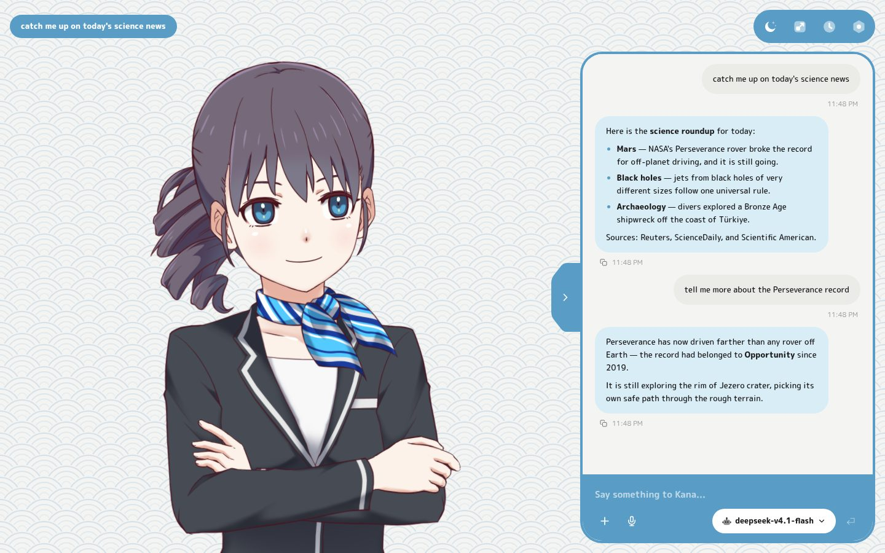
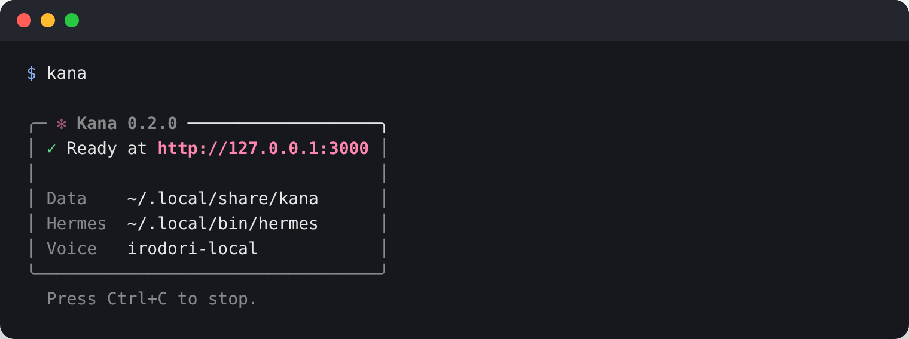
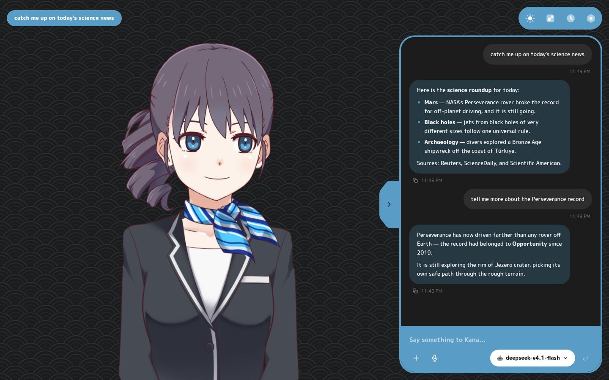
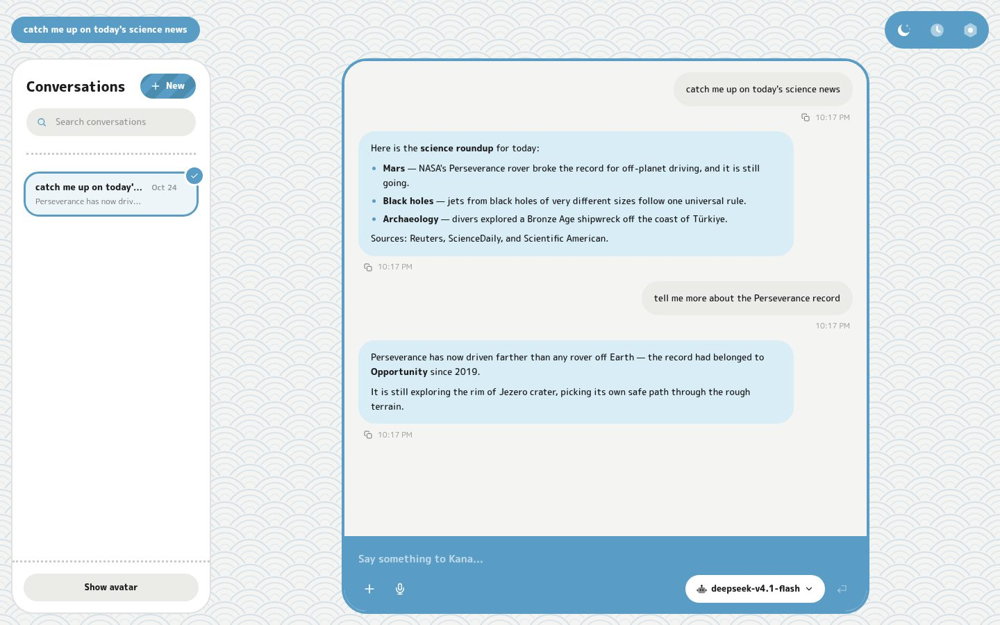
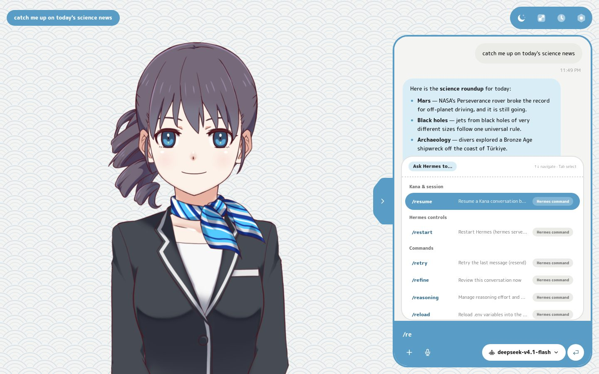
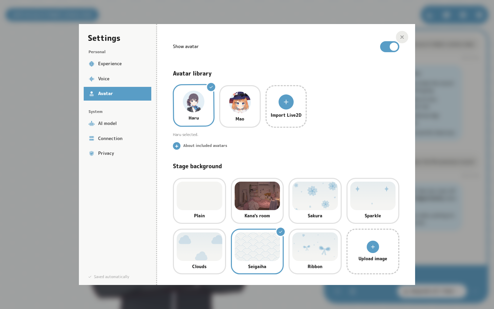
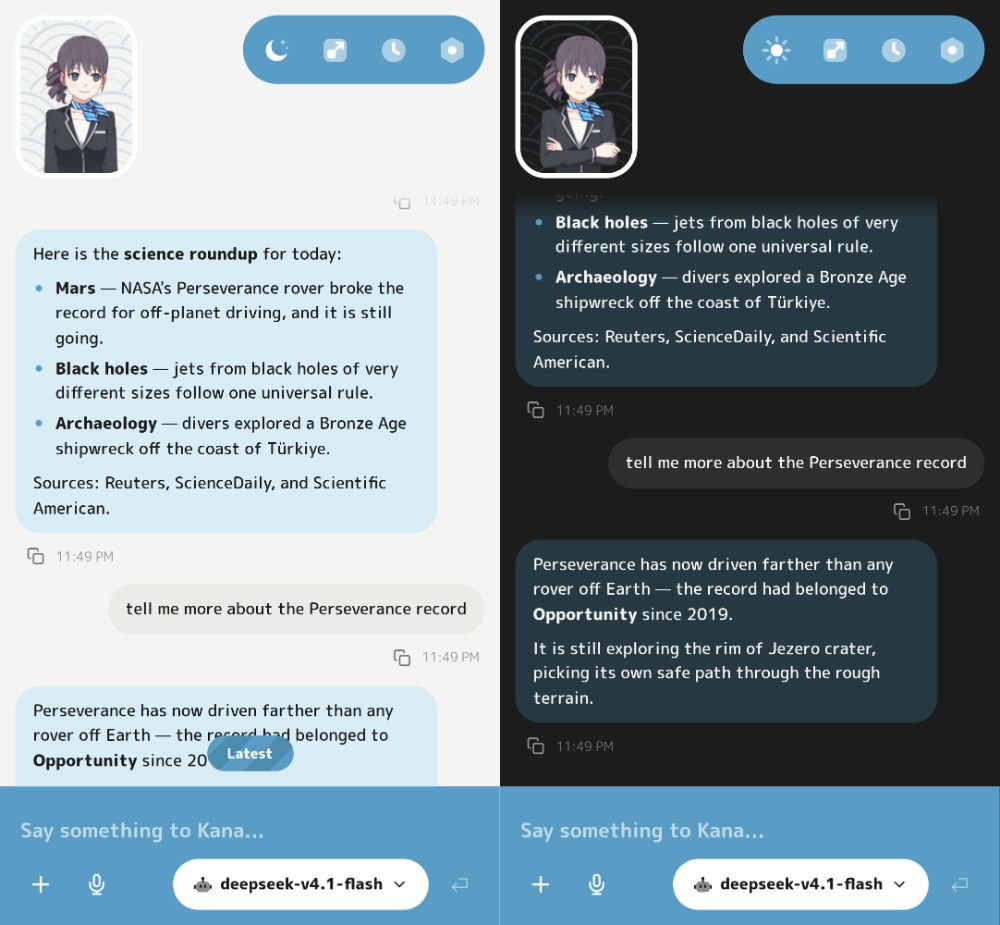
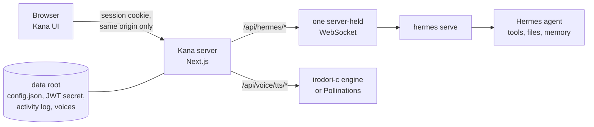

<div align="center">


# Kana Hermes Waifu Assistant

**A waifu assistant for your [Hermes Agent](https://github.com/NousResearch/hermes-agent): a living, talking anime face for the Hermes you already run.**

Kana turns Hermes into a Hermes waifu: a Live2D character who answers in the language you write in and, with her voice on, speaks every reply in Japanese with lip sync.
Hermes stays the only agent: its tools, files, memory, and sessions work exactly as before.

[](https://www.npmjs.com/package/kana-alya)
[](LICENSE)




</div>

## Contents

- [Quick start](#quick-start)
- [Screenshots](#screenshots)
- [Features](#features)
- [Deploy on a VPS](#deploy-on-a-vps)
- [Connecting to Hermes](#connecting-to-hermes)
- [Voice](#voice)
- [Live2D avatars](#live2d-avatars)
- [How it works](#how-it-works)
- [Development](#development)
- [Documentation](#documentation)
- [Credits](#credits)

## Quick start

You need **Linux x64 (glibc)**, **Node.js 22.13+**, and
[Hermes Agent](https://github.com/NousResearch/hermes-agent) installed.

```bash
npm install -g kana-alya
kana
```

The first run asks you to create an access password, then opens Kana in your
browser. There is no default password.

<p align="center">
  
</p>

Useful commands:

| Command | What it does |
|---|---|
| `kana` | Start Kana on this computer and open the browser |
| `kana serve` | Run headless for a VPS or systemd service |
| `kana password` | Create or change the access password (`--stdin` for scripts) |
| `kana doctor` | Check Node.js, Hermes, password, voice, and data folders |
| `kana setup` | Explain the optional local voice engine download |
| `kana config` | Open the advanced `config.json` |
| `kana migrate` | Move a `KANA_DATA_DIR` root into `~/.kana` |

Your data (password hash, settings, voice profiles, model cache) lives in
`$KANA_DATA_DIR` when set, otherwise `~/.kana`. An install from an earlier
release is moved there automatically on the next `kana` run; a root you named
with `KANA_DATA_DIR` is never touched by a start, and `kana migrate` copies it
into `~/.kana` when you ask for it.

## Screenshots

<table>
  <tr>
    <td width="50%"></td>
    <td width="50%"></td>
  </tr>
  <tr>
    <td align="center"><sub>Dark theme and stage patterns</sub></td>
    <td align="center"><sub>Focus mode: your conversations beside the chat</sub></td>
  </tr>
  <tr>
    <td width="50%"></td>
    <td width="50%"></td>
  </tr>
  <tr>
    <td align="center"><sub>Hermes slash commands, read live from your installation</sub></td>
    <td align="center"><sub>An avatar wardrobe and stage backgrounds</sub></td>
  </tr>
  <tr>
    <td colspan="2" align="center"></td>
  </tr>
  <tr>
    <td colspan="2" align="center"><sub>Chat-first on phones, with Kana in a call-style tile</sub></td>
  </tr>
</table>

## Features

**Conversation**
- Replies in the language you write in, as Markdown (lists, code, links), with
  no language setting to pick. With the voice on, Kana also speaks each reply
  in Japanese; switching language affects new replies only.
- History comes from Hermes, so conversations follow you to other browsers.
- The Hermes activity log shows which tools ran for each reply.
- Files Hermes sends (audio, video, images, documents) appear as a player, a
  preview, or a Download button instead of a file path.
- Copy any message with one button: a reply keeps its copy button in view, your
  own appears when you point at that message, and a touch screen always shows it.
- Composer with file attachments, voice dictation, and a model picker.
  The picker opens with the last Hermes model list at once and refreshes it in
  the background.
- On phones and tablets the conversation fills the screen and Kana sits in a
  small call-style tile framed on the face.

**Hermes controls**
- The live, categorized `/` command catalog with argument completion, including
  your installed skills.
- Dedicated dialogs for approvals and clarifications. Sudo passwords and secrets
  are never stored.
- `/new`, `/sessions`, `/resume`, `/branch`, `/title`, `/status`, `/compress`, and more.
- `/restart` restarts the `hermes serve` Kana started and brings you back to
  the same conversation; `/reload` applies `~/.hermes/.env` changes. Models
  added to Hermes's `config.yaml` appear in the model picker without either.

**Character**
- Live2D avatars: the official Haru and Mao samples, or a model folder
  imported into your browser. Settings → Avatar is a wardrobe of portrait
  cards.
- Emotions, motions, lip sync, and cursor-following gaze.
- Stage backgrounds (an illustrated room, soft patterns, or your own image), plus
  light and dark themes.

**Voice**
- Local Japanese speech with Irodori-TTS v4.1 Anime on a CPU engine, with voice cloning from a short, consented sample.
- Or an external voice service: Pollinations (ElevenLabs, Qwen TTS, Grok TTS, and more).
- Lip sync follows the audio, and Stop cancels generation on the server.

**Security and operations**
- Password sign-in with lockout that never blocks your own known browsers and
  does not depend on IP addresses (safe behind shared home internet).
- An optional prompt guardrail you write in your own `config.json` as plain
  rules ("never read anything under Y"). Kana turns them into one yes/no question
  for TypeSafe's Jev and refuses the turn before Hermes sees it. The rules ship
  as five editable starters, and the layer is skipped while the key is empty.
- Cross-site request protection, server-side logout, and an owner-only data folder.
- Installable app shell, and safe diagnostics that redact tokens, prompts, and
  secrets.
- A configuration guide inside Kana at `/docs`, in English and Indonesian.

## Deploy on a VPS

`kana serve` runs the same app headless. Set the password once as the account
that owns Hermes, then run Kana behind HTTPS:

```bash
kana password                       # in the same account that runs Hermes
kana serve --port 3000
```

Kana keeps its files in `~/.kana` in that account, exactly as it does on a
desktop. A service unit does not need a second data root: it must already run
as the user that owns Hermes, because Linux only lets that user read the Hermes
session token. Set `KANA_DATA_DIR` only when you deliberately want the state
somewhere else.

- Put Nginx in front for HTTPS. Use `proxy_set_header Host $http_host;`, disable
  buffering for `/api/hermes/events`, and allow `client_max_body_size 14m`.

The complete systemd unit and Nginx configuration are in the
[VPS deploy checklist](docs/operator/supported-environment.md#vps-deploy-checklist).
To build from source instead of npm, see [Install Kana](docs/operator/install.md).

> [!WARNING]
> `npm run dev` is a development server only. Never keep it running behind
> Nginx or on a VPS.

## Connecting to Hermes

Usually there is nothing to do. Kana:

1. finds the Hermes executable in `PATH` or the usual install locations (the
   official installer, pipx, uv, Nix, Homebrew, and Termux);
2. adopts a running `hermes serve` owned by the same user, or starts one on
   `127.0.0.1` with a token that only the Kana server knows;
3. connects your browser through Kana's authenticated relay.

If detection fails, `kana doctor` shows what it found. Set
`hermes.executable` in `config.json` to an absolute path and restart Kana.
Details: [Hermes auto-detection on Linux](docs/operator/supported-environment.md#hermes-auto-detection-on-linux).

To start Hermes yourself, give it a token Kana can discover:

```bash
HERMES_DASHBOARD_SESSION_TOKEN="a-long-random-token" hermes serve --host 127.0.0.1 --port 9119
```

After you change Hermes's configuration, you rarely need to leave Kana:

| Change | What to do |
|---|---|
| A model or provider added to `config.yaml` | Nothing. It appears in the model picker right away. |
| `~/.hermes/.env` (API keys) | Type `/reload`. |
| MCP servers | Type `/reload-mcp now`. |
| Anything else Hermes reads at startup | Type `/restart`. Kana restarts the `hermes serve` it started and resumes the conversation. A Hermes you started yourself is restarted where you started it. |

## Voice

Voice is optional and off on new installs. Turn Kana's voice on or off in
**Settings → Voice**; replies always stay readable as text.

- **Local Irodori TTS (default).** [Irodori-TTS v4.1 Anime](https://huggingface.co/phasefield-audio/Irodori-TTS-v4.1-Anime)
  on the [irodori-c](https://github.com/misaalya/irodori-c) engine, on the CPU of the
  machine running Kana (Linux x86-64; no Python or GPU). Nothing is downloaded
  until you press **Download voice engine** in Settings → Voice: about 480 MB for
  the engine and 3.1 GB for the model, checksum-verified and resumable. A model
  already in your Hugging Face cache is reused instead of downloaded.
  Pick the bundled Kana voice, the model's own faster voice, or clone one from a
  consented sample.
- **Pollinations.** Set `tts.provider` to `pollinations` with your key, model, and
  voice. Each external service is its own integration; API keys stay in the
  server's `config.json` and never reach the browser.

Configuration examples are in [Speech](docs/operator/configure.md#speech),
including every local engine option. CPU synthesis is slower than realtime on
modest hardware; the engine's int8 path is used automatically on CPUs with
AVX-512 VNNI.

## Live2D avatars

Choose **Haru** or **Mao** in **Settings → Avatar**, or import a model folder
with the **Import Live2D** card. Each avatar is a card with its portrait, which
Kana takes from the stage and keeps in your browser. Imported folders stay in
your browser (IndexedDB) and are never uploaded. An imported avatar's ⋯ menu
has its size, Rename, and Remove, and it has its own bindings for the mouth
parameter, emotion expressions, and motion groups, which you can preview before
saving.

The official samples load from Live2D's pinned sample repository and are not
redistributed by Kana.

> This content uses sample data owned and copyrighted by Live2D Inc. The sample
> data are utilized in accordance with terms and conditions set by Live2D Inc.
> This content itself is created at the author's sole discretion. See the
> [official sample model terms](https://www.live2d.com/en/learn/sample/model-terms/).

## How it works



Hermes events are translated into a stable internal model that drives the
transcript, activity log, avatar emotion, and audio. Hermes starts each reply
with a short header (the emotion, the language, and the Japanese speech while
the voice is on) and then writes the answer in Markdown. In the
browser, each workspace keeps its shared state in small per-concern
[zustand](https://github.com/pmndrs/zustand) stores, and plain service classes
talk to Hermes, voice, and the avatar, so typing re-renders only the composer.

That split is also the trust boundary. The browser holds a Kana session cookie
and no secret of any kind: the Hermes session token, your voice service keys,
and the guardrail key stay in the server process, and every Hermes request
travels through Kana's authenticated relay. Files Hermes delivers arrive as
signed links, never as filesystem paths, and each download re-checks the file.

The one file both sides can reach is `config.json`, because Hermes and Kana run
as the same user. Kana creates it once, owner-only, and never rewrites it, so
your guardrail rules stay yours unless the agent writes them. To put them
beyond the agent's reach, the [security model](docs/operator/security.md)
documents the operating-system lock (`chattr +i`), what it cannot do, and the
threat checklist for a server install.

More on how those boundaries are enforced:
[process boundaries](docs/decisions/0001-process-boundaries.md).

## Development

```bash
git clone https://github.com/misaalya/kana-hermes.git
cd kana-hermes
npm ci
npm run password                         # once, for your local data folder
npm run dev -- --hostname 127.0.0.1      # http://127.0.0.1:3000
```

Build and run the production package from the checkout:

```bash
npm run package:local
node bin/kana.mjs
```

Checks:

```bash
npm run lint && npx tsc --noEmit && npm test   # fast
npm run quality                                # full gate, including browser journeys
```

Real-environment checks (need Hermes, network, or target hardware) are
`npm run test:hermes:restart`, `npm run test:live2d:official`, and
`npm run test:package:npm`. Local-voice latency stays a manual check on the
target machine, because Kana ships no latency harness.
`npm run screenshots:readme` photographs the README images out of the real UI,
against a stand-in conversation and Live2D's official samples, into
`.github/readme/`; a person still judges the result.
Contributor rules are in [AGENTS.md](AGENTS.md).

## Documentation

| Topic | Guide |
|---|---|
| Every `config.json` setting, inside Kana | Open `/docs` in Kana (English and Indonesian) |
| Installing locally or on a server | [Install Kana](docs/operator/install.md) |
| `config.json`, TTS providers, deployment mode | [Configure Kana](docs/operator/configure.md) |
| Attachments, dictation, model picker | [Use the composer](docs/operator/composer.md) |
| VPS, systemd, Nginx, supported platforms | [Supported environment](docs/operator/supported-environment.md) |
| Threat model and reverse proxy | [Kana security model](docs/operator/security.md) |
| Release channels and Hermes compatibility | [Compatibility](docs/operator/compatibility.md) |
| Quality gates and releases | [Quality gates](docs/agent/quality-gates.md) · [Release checklist](docs/evidence/release-checklist.md) |
| The documentation map | [docs/README.md](docs/README.md) |
| Changes and migration notes | [CHANGELOG.md](CHANGELOG.md) |

## Credits

Kana's Live2D stage is modelled on [Project AIRI](https://github.com/moeru-ai/airi):
its Pixi 6 stage architecture, model fitting, motion-manager and lip-sync hooks,
guarded render, design style, and cursor-following gaze were the reference implementation for
Kana's avatar layer.

The security and installation shape follows
[9router](https://github.com/decolua/9router): the deny-by-default proxy and
dashboard sign-in pattern, the login limiter, the JWT session cookie, the
manual-update dialog, and the split between a private app and a published CLI
package.

Both projects are references for the implementation; Kana does not bundle
either repository.

## License

[MIT](LICENSE). Live2D sample models are subject to Live2D's own terms, above.
